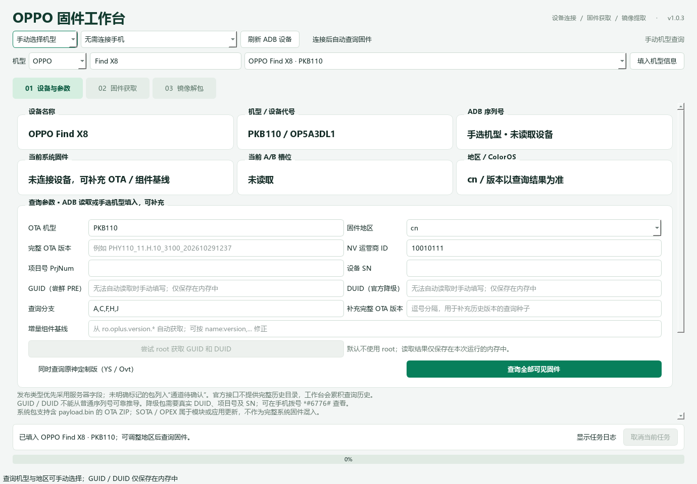

# OPPO 固件工作台

Windows 桌面固件查询、下载与 OTA payload 镜像提取工具。界面分为“设备与参数”“固件获取”“镜像解包”三个部分，支持 OPPO，兼容一加、realme。可以通过 ADB 读取设备，也可不连接手机，手动选择机型查询和在线解包。

[下载 Windows x64 便携包](https://github.com/Ayc-Gh/OPPOFirmwareTool/releases/latest/download/OPPOFirmwareTool-Windows-x64.zip) · [全部发布版本](https://github.com/Ayc-Gh/OPPOFirmwareTool/releases) · [更新记录](docs/更新记录.md)



当前版本 **v1.0.5**：新增官方 OPEX 热修复与模块补丁包获取能力（支持 Patch01/Patch02 等官方微补丁与运营商补丁，界面新增【补丁包】独立分类并支持直接下载）；新增官方降级包一键推送与安装唤起（基于 ColorOS 助手逆向成果，免 Root，免解 BL 锁），随包集成官方伴生应用（`OTA_17.apk` 与 `OTA_113.apk`）；保留可搜索的手动机型选择（内置 1,185 个机型条目），自动填入公开型号、设备代号和地区默认值，接入固件查询、下载和在线解包。46 项自动化测试通过。独立社区项目，与 OPPO 官方无隶属关系。

## 运行

解压 `OPPOFirmwareTool-Windows-x64.zip` 后运行 **OPPOFirmwareTool.exe**，并保留同目录的 `_internal`、`tools` 和 `licenses` 文件夹。不需要安装 Python 或 Go。推荐 Windows 10/11 x64。

1. 手机启用 USB 调试，连接电脑，在手机上授权。点击“刷新 ADB 设备”，选择设备。名称、序列号、机型、设备代号、系统版本、A/B 槽位和固件地区会自动展示。
2. 默认在连接后查询固件。可取消自动查询，或在“设备与参数”补填 GUID、DUID、项目号、OTA 版本、组件基线和查询分支，再点击“查询全部可见固件”。已 root 的设备可手动点击“尝试 root 获取 GUID 和 DUID”自动填入标识；如果手机弹出 root 授权，请在手机上处理。启动、刷新设备和查询固件均不会主动使用 root。
3. 在“固件获取”依次选择发布类型、ColorOS 大版本、全量/增量类型；关键词可搜索版本、OTA、组件和安装基线。记录按日期倒序排列。同一版本的全量与增量包分别保留。
4. 单击列表中的包版本可复制 OTA 名称；单击链接或“复制链接”复制下载地址。“刷新此包链接”重新执行该包的原始查询。若服务器已撤下该版本，会明确提示无法续签。
5. 点击“下载完整固件”，选择保存位置。下载使用 `.part` 断点文件；再次选同一文件名可续传。校验通过后才发布最终 ZIP。哈希失败时保留临时文件并提示换用新文件名。
6. 本地解包：在“镜像解包”选择 OTA ZIP 或 `payload.bin`，读取镜像清单，选择输出目录并勾选镜像。
7. 在线解包：点击固件列表里的“在线选择镜像”，或在解包页按类型、ColorOS 版本、关键词选择在线固件，也可粘贴直链。读取清单后选择一个、多个或全部镜像，指定输出目录。
8. 增量分区还需要对应基线版本的原始 `分区名.img` 目录。程序会先验证基线大小和 SHA256，再执行合成。输出目录应为空，已有同名镜像时会拒绝覆盖。
9. 降级包推送：在“固件获取”选中降级包后点击“推送此固件至手机并安装”，或点击“推送本地降级包…”选择电脑上的任意 `.ozip` 或 `.zip` 官方固件。程序自动检测手机存储空间、安装官方降级伴生应用，并通过 ADB 推送固件至内部存储，写入本地安装参数并拉起系统更新界面（免 Root，免解 BL；降级会清除个人数据，请提前备份）。

**不连接手机的用法：** 顶部切换为“手动选择机型”，选择 OPPO / 一加 / realme，按名称、型号或设备代号搜索并选择机型，即会填入参数；也可点击“填入机型信息”重新填入。确认固件地区后，点击“查询全部可见固件”，再按类型和 ColorOS 大版本选择下载或在线提取镜像。未收录的型号可选“自定义机型”，在参数中手填 OTA 机型与地区。

手选只填公开信息：不会套用已连接手机的 SN、项目号、GUID、DUID、当前版本或组件。国行 P 系列代码默认 cn，其余型号先选择实际固件地区；NV 随地区填入默认值，可修正。切换机型或地区会清除旧的在线镜像来源和清单；本地解包文件保持可用。刷新 ADB 不会覆盖手选对象，切回 ADB 模式可重新读取手机信息。

“全选全部镜像”也会选中被搜索隐藏的镜像，界面会明确显示总选择数量。任务可取消；界面通过后台线程执行查询、下载和解包。

## 查询能力与边界

- 查询 `manual`、`client_auto`、`server_auto`、`taste`、招募请求及有 GUID 时的 PRE 尝鲜请求。遍历 A/C/F/H/J 分支，可添加其他分支及完整版本种子。可选 YS/Ovt 定制版。国区支持官方降级查询。
- **官方更新接口不是历史固件搜索引擎。** 它根据机型、地区、源版本、组件、测试资格返回当前可见更新。工具累计本地查询历史和已连接设备的组件基线，并复用已发现的查询种子；增量查询同时覆盖当前基线和已记录的历史基线。当前版本没有更新不代表该机型没有历史增量包；仍不能保证列出厂商全部历史、已撤包或受限测试版本。
- 机型目录从 [Google Play 公布的设备列表](https://support.google.com/googleplay/answer/1727131) 整理名称、型号和设备代号，来源与快照校验值见 `oplus_tool/data/model_catalog.json`。条目收录不代表厂商一定提供可用 OTA，部分旧机型也不使用 payload。未连接手机时，增量仍需已记录/内置的匹配组件基线或手动补充；降级和受限 PRE 仍需真实设备参数。可运行 `python scripts/update_model_catalog.py` 更新源码中的目录，发布包使用随附快照，无需联网加载机型。
- 优先用服务器发布字段判定正式/尝鲜/灰度性质；缺少明确字段时显示“通道待确认”。`taste` 返回的包不一定是测试版，不会仅凭请求模式把正式包误标为尝鲜版。
- 尝试读取 payload manifest，确认全量/增量；类型不明确的组件查询结果标为“待核验”。增量安装基线保持为该次请求对应的源 OTA，metadata 补充构建 ID；提取前验证旧镜像哈希。每个源 OTA 都使用与其匹配的组件集，不将当前手机的组件套到其他历史版本上。
- 内置少量从官方全量包中提取、核验过的公开组件基线，当前包含 PHY110 国区的 A.53 和 F.28。只在机型、地区、运营商 NV 匹配时使用；其中 F.28 可查询到 `16.0.10.500 → 17.0.0.100` 的 3.59 GiB 增量包。其他机型随着普通 ADB 连接积累各版本基线；基线资料和服务器保留情况仍会限制历史增量的覆盖范围。
- 填入真实 GUID 时会同时保留公开 v3 与设备资格 v6 的增量查询；通过公开接口取得的包在刷新链接时仍使用公开接口，避免切换资格接口后反而漏包。
- 更新日期优先使用服务器发布时间（UTC+8）。未提供发布时间时，使用 OTA/metadata 中的构建时间，并标明“非推送日期”。
- GUID、DUID 不能从设备 SN 可靠推导；普通 ADB 可能无法读取。降级需真实 DUID、5 位项目号和 SN；可在手机拨号 `*#6776#` 查看。PRE 版本可能仍受厂商资格名单限制。
- 手动 root 读取只访问 `/data/system/openid_config.xml` 的 GUID 及 `/data/user/0/com.oplus.ota/shared_prefs/cache.xml` 的 DUID，并校验 64 位十六进制格式。读取失败或只取得其中一项时保留另一项已有输入。结果仅在本次运行内存中按设备区分，切换设备不会套用其他设备的标识；刷新相同设备可保留本次已取得的值。
- ColorOS 动态链接支持 `downloadCheck` 重定向。需要 PKI 设备授权的 `/download?` 接口会明确报错，需使用官方授权产生的可下载地址。本工具没有内置证书、keybox 或伪造授权。
- 官方 OPEX 热修复与模块补丁包在列表中归为【补丁包】展示并提供高速直链下载；SOTA 是软件应用热更新，上游旧 IoT、耳机、穿戴及 realme EDL 查询不属于本工具的 OPPO OTA 工作流。

## 解包引擎

| 引擎 | 使用方式 | 校验 |
|---|---|---|
| ssut 2.1.0 | 本地 ZIP/bin；在线按范围取得所选操作数据；增量合成 | 保留引擎默认操作/基线/镜像校验，并再次核验输出 SHA256 |
| xishang v0.1.6 | 原生 HTTP Range 在线提取及本地提取 | 工作台独立核验输出大小与 manifest SHA256 |

自动模式对本地及增量使用 ssut；普通在线提取优先使用 xishang，启动或读取失败时退回 ssut 按需提取。可以手动选择引擎或指定替换路径。发布包的 xishang 为上游 Windows amd64-v3 构建，较老 CPU 请选 ssut。

在线 ssut 提取会生成仅含所选分区数据的临时 payload，重排数据偏移，保留操作和目标镜像哈希，删除不再适用的 metadata 签名。它只是解包中间文件，不是可安装固件；本工具核验完整性，不验证固件签名信任链。

支持含 `payload.bin` 的 OTA ZIP 和原始 payload v2。远程 ZIP 中的 payload 必须未压缩，且服务器必须正确支持 HTTP Range；否则请先完整下载后本地解包。加密 OFP/OZIP、EDL 包不支持。部分增量操作如 PUFFDIFF、ZUCCHINI、LZ4DIFF 当前引擎不支持，会在提取前提示选择其他分区或全量包。没有目标哈希时会计算本地 SHA256 并明确标明无法与官方值比对。

## 本地数据

查询历史与固件组件基线：`%LOCALAPPDATA%\OPlusFirmwareTool\catalog.sqlite3`。基线只保存公开固件版本和组件版本，不含设备身份凭证。工具路径和默认目录：同目录的 `settings.json`。GUID/DUID 仅在内存中使用，不写入查询记录、设置、日志或导出文件。普通 ADB 操作用于枚举设备和读取属性；只有手动点击 root 获取按钮后才会请求 su 并读取标识配置。工具不执行刷机、切槽、解锁或手机写入命令。

镜像输出包含 `extraction-report.json`，记录引擎、OTA metadata、文件大小和 SHA256。最终镜像只在全部所选镜像通过核验后发布。

## 源码运行与构建

```powershell
python -m pip install -r requirements.txt
python setup_tools.py
python app.py
python -m unittest discover -s tests -v
python build.py
```

ADB 已附带。也可将 Android 官方 platform-tools 的 `adb.exe`、`AdbWinApi.dll`、`AdbWinUsbApi.dll` 放到 `tools`，或在界面指定路径。`setup_tools.py` 下载锁定版本引擎，并核验 ssut 发布方提供的 checksum；xishang 发布没有独立 checksum，记录通过 HTTPS 获取文件的本地 SHA256。请查看 `tools/versions.json`。

## 鸣谢与参考项目 (Acknowledgments)

本项目在研发与迭代过程中深度参考并吸收了开源社区与上游项目的优秀成果，谨向以下项目及作者致以诚挚敬意与感谢：

- **[OPlus-Tracker](https://github.com/JerryTse-OSS/OPlus-Tracker)**（作者：**Jerry Tse** 及贡献者，LGPL-3.0）  
  OPPO / 一加 / realme OTA 查询协议与官方降级协议逆向研究的核心参考。本项目在其基础上重构了结构化响应访问、流式重定向、受限退避与安全降级校验机制。
- **[payload-dumper-go](https://github.com/ssut/payload-dumper-go)**（作者：**ssut** 及贡献者，Apache-2.0）  
  提供卓越的本地 OTA payload 解析、增量差分镜像合成以及分区哈希严格校验能力。
- **[payload-dumper-go](https://github.com/xishang0128/payload-dumper-go)**（作者：**xishang0128** 及贡献者，GPL-3.0）  
  原生 HTTP Range 在线解包实现，为免下载完整大包直接提取关键分区镜像提供了重要支持。
- **[Google Play Supported Devices](https://support.google.com/googleplay/answer/1727131)**  
  提供 1,185 款 OPPO、一加、realme 官方公开设备名称、型号与代号的基础公开数据源。
- **ColorOS 官方升级助手逆向成果及社区玩机先驱**  
  官方降级协议通道、`DataSharedProvider` 本地安装标记注入机制以及伴生 APK 的通信协议逆向分析支持。
- **[Android Open Source Project (AOSP)](https://source.android.com/) & Platform Tools**  
  提供稳定的 ADB 底层通信与推送工具。

## 许可证与说明

完整研究与适配说明见 [docs/项目研究与实现.md](docs/项目研究与实现.md)，测试记录见 [docs/验证报告.md](docs/验证报告.md)。上游许可、修改说明和源码位置见 [THIRD_PARTY_NOTICES.md](THIRD_PARTY_NOTICES.md)。项目按 GPL-3.0-only 提供。
